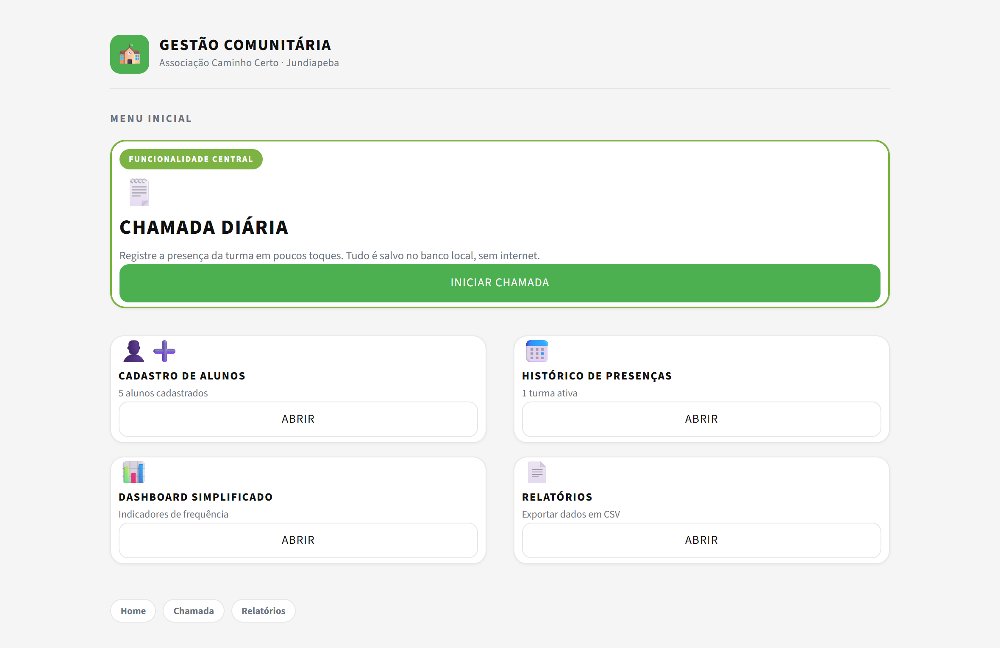
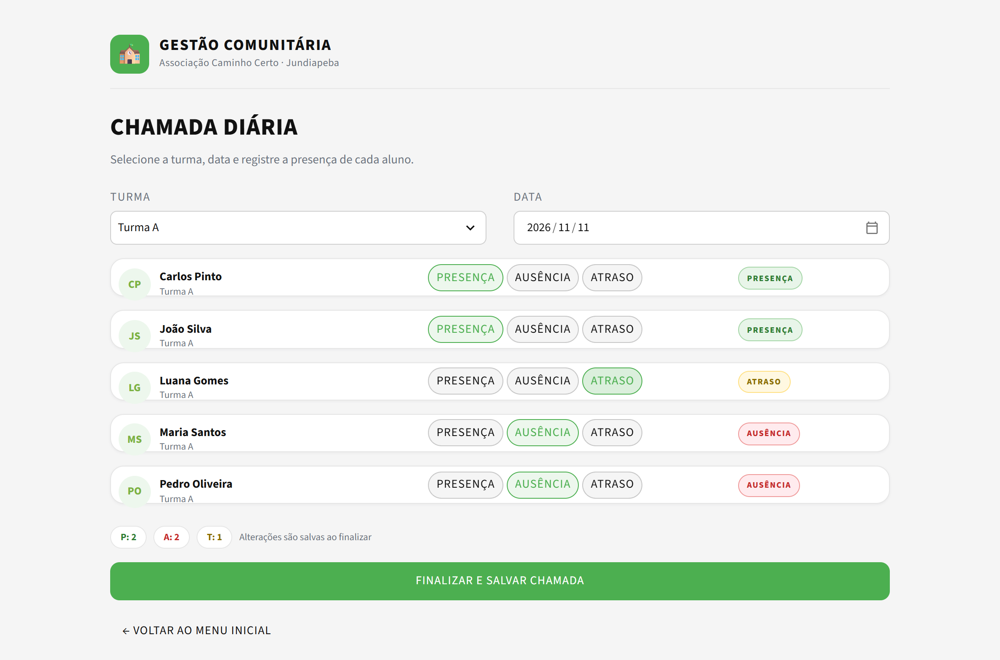
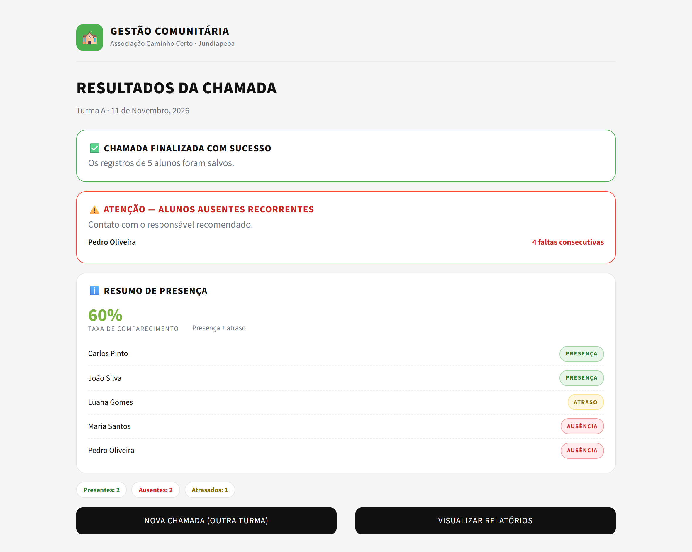
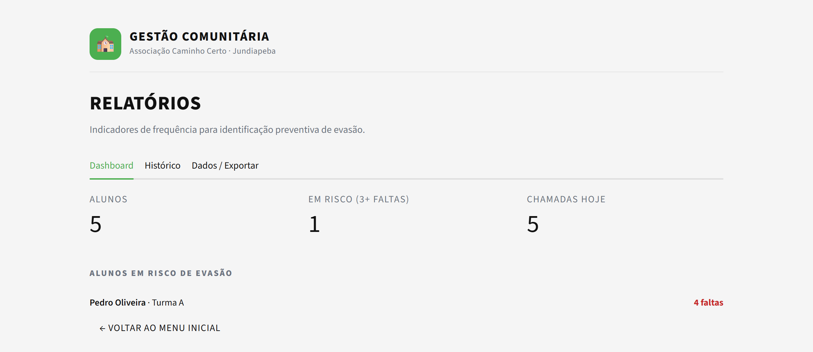
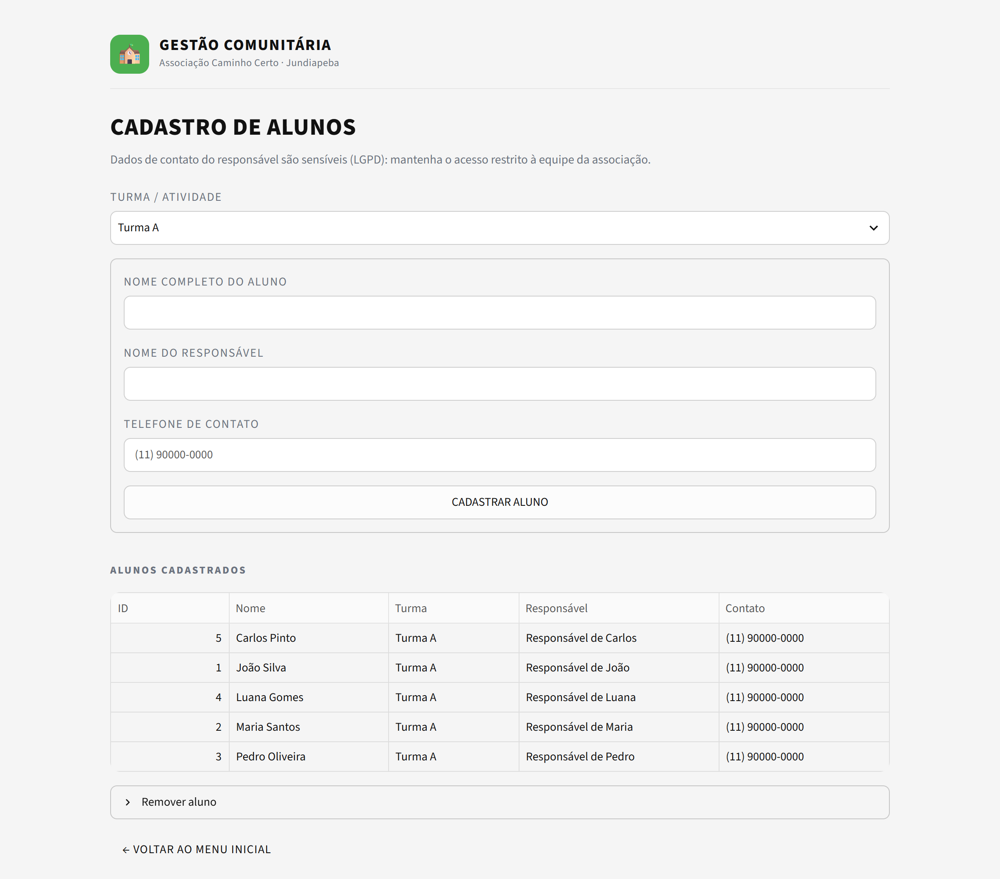

# Associação Caminho Certo — Gestão Escolar e Combate à Evasão

MVP em **Python + Streamlit + SQLite** para registro de frequência e identificação
preventiva de alunos em risco de evasão, na Associação Caminho Certo (Jundiapeba).

**▶ App publicado:** https://caminho-certo.streamlit.app

- **ODS 4** — Educação de Qualidade
- **ODS 10** — Redução das Desigualdades

## Telas

| Tela | Arquivo/função | O que faz |
|---|---|---|
| 1. Menu Inicial | `render_home` | Dashboard com a ação central (Chamada Diária) e atalhos |
| 2. Chamada Diária | `render_chamada` | Seleciona turma e data, marca PRESENÇA / AUSÊNCIA / ATRASO |
| 3. Resultados | `render_resultado` | Confirma o salvamento, mostra taxa e alerta faltas consecutivas |
| Apoio | `render_alunos` | Cadastro e remoção de alunos |
| Apoio | `render_relatorios` | Indicadores, histórico e exportação CSV |

## Telas do sistema

Capturas reais do sistema em execução, com os dados de demonstração
(`scripts/seed_demo.py`). Para regerá-las, veja a seção [Apresentação](#apresentação).

### 1. Menu Inicial

Ponto de partida da coordenação: a chamada em destaque e os atalhos em grade.



### 2. Chamada Diária

Turma e data no topo, um cartão por aluno e contadores de presença em tempo real.



### 3. Resultados da Chamada

Confirmação do salvamento, alerta de ausências recorrentes e taxa de comparecimento.



### Telas de apoio

| Relatórios | Cadastro de Alunos |
|---|---|
|  |  |

## Como rodar

```powershell
# na raiz do projeto
py -m venv .venv
.\.venv\Scripts\Activate.ps1
pip install -r requirements.txt

streamlit run src/app.py
```

O app abre em `http://localhost:8501`. O banco é criado automaticamente em
`data/db.sqlite3` na primeira execução.

Para começar com dados de demonstração (5 alunos + 3 dias de histórico):

```powershell
.\.venv\Scripts\python.exe scripts\seed_demo.py
```

Para zerar tudo, basta apagar `data/db.sqlite3`.

## Deploy

O sistema está publicado no **Streamlit Community Cloud** (plano gratuito):

### 🔗 https://caminho-certo.streamlit.app

O link abre com dados de demonstração (5 alunos na Turma A e 3 dias de chamada),
para que qualquer pessoa consiga navegar pelas três telas sem cadastrar nada.

| Configuração | Valor |
|---|---|
| Repositório | `Marcosvx96/Caminho-Certo` |
| Branch | `main` |
| Arquivo principal | `src/app.py` |
| Python | 3.14 |
| Secret | `demo = true` |

### Como os dados de demonstração funcionam

O seed é **opcional e desligado por padrão** (`src/demo.py`). Ele só roda quando:

- o secret `demo = true` está definido (Streamlit Cloud), ou
- a variável `CAMINHO_CERTO_DEMO=1` está definida (uso local).

E só popula o banco **se ele estiver vazio** — nunca sobrescreve dados reais. Em uso
normal, sem o secret, o app abre vazio e a associação cadastra seus próprios alunos.

### Limitação do plano gratuito

O banco SQLite fica no disco do container, **que é recriado a cada reinício ou
republicação** do app. Para o link de avaliação com dados fictícios isso é suficiente.
Para uso real da associação, o próximo passo técnico é:

- trocar o SQLite por um banco gerenciado (Postgres, Turso/libSQL), ou
- hospedar em um serviço com disco persistente (Railway, Fly.io, VPS).

O código já concentra o acesso ao banco em `src/database.py`, então a troca é
localizada: basta adaptar a conexão e os `INSERT ... ON CONFLICT` para o novo banco.

## Apresentação

O PDF de apresentação do projeto está em
[`docs/Apresentacao_Caminho_Certo.pdf`](docs/Apresentacao_Caminho_Certo.pdf) — 10 páginas
em A4 paisagem: capa, problema/solução, arquitetura, uma página por tela (com captura
real do sistema), telas de apoio, testes/correções e como executar.

Para regerar (usa o Edge já instalado, sem baixar navegador):

```powershell
pip install playwright fpdf2
.\\.venv\\Scripts\\python.exe scripts\\capturar_telas.py   # app precisa estar rodando
.\\.venv\\Scripts\\python.exe scripts\\gerar_pdf.py
```

As capturas ficam em `docs/screenshots/`.

## Testes

```powershell
.\.venv\Scripts\python.exe -m pytest tests/ -v
```

Os testes usam **banco temporário isolado** (variável `CAMINHO_CERTO_DB`) — nunca
tocam nos dados reais.

## Modelo de dados

```
alunos(id, nome, turma, responsavel, contato, criado_em)
frequencias(id, aluno_id, data, status)   -- status: P | A | T
  UNIQUE(aluno_id, data)                  -- impede duplicidade no mesmo dia
  FOREIGN KEY(aluno_id) → alunos(id) ON DELETE CASCADE
```

Salvar a chamada duas vezes no mesmo dia **atualiza** os registros (UPSERT), em vez
de duplicá-los.

## Regras de negócio

- **Taxa de comparecimento** = `(presenças + atrasos) / total de registros`.
  Atraso conta como comparecimento; ausência não.
- **Alerta de evasão** = 3 ou mais ausências **consecutivas** a partir do registro
  mais recente do aluno.

## Acessibilidade

- Tema de alto contraste definido em `.streamlit/config.toml`
- Verde como cor primária, chips semânticos (verde/vermelho/amarelo) com texto —
  a cor nunca é o único indicador de status
- Rótulos em maiúsculas e pesos fortes para leitura rápida

## LGPD

O sistema armazena nome de crianças/adolescentes e telefone de responsáveis.
Recomendações:

- Acesso restrito à equipe da associação
- `data/*.sqlite3` está no `.gitignore` — **nunca** versione o banco
- Defina prazo de retenção e responsável pelo tratamento dos dados
- Colete consentimento dos responsáveis no cadastro

## Autoria e participação

| Pessoa | Participação |
|---|---|
| **Marcos Vinicius** | Concepção e desenvolvimento do MVP: levantamento de requisitos, modelagem do banco, implementação das telas, testes automatizados e documentação. |
| **Ana Paula Souza** | Colaboração no contexto e no levantamento do problema: a realidade da associação, o desafio da evasão e as necessidades que o sistema deveria atender. |

Projeto desenvolvido para a **Associação Caminho Certo** (Jundiapeba, Mogi das Cruzes).

## Estrutura

```
Caminho Certo/
├── .github/workflows/ci.yml
├── .streamlit/config.toml
├── data/                    # banco local (ignorado no Git)
├── docs/
│   ├── Apresentacao_Caminho_Certo.pdf
│   └── screenshots/         # capturas usadas no README e no PDF
├── scripts/
│   ├── seed_demo.py         # dados de demonstração
│   ├── capturar_telas.py    # captura as telas do app
│   └── gerar_pdf.py         # monta o PDF de apresentação
├── src/
│   ├── app.py               # interface e roteamento
│   ├── database.py          # CRUD e schema SQLite
│   ├── reports.py           # indicadores e CSV
│   └── styles.py            # identidade visual
├── tests/
│   ├── conftest.py          # banco isolado
│   └── test_app.py
├── requirements.txt
└── README.md
```
